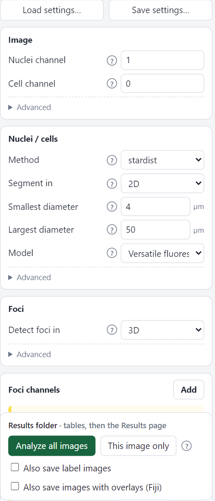

# Settings and runs

The left side of the **Analyze** page holds the analysis settings and the buttons that run the analysis on
all images. The middle is the [viewer](viewer.md); the right side its display and the result of the shown
image.

<figure markdown>
{ width="300" }
</figure>

## The settings

The settings are grouped in sections: **Image**, **Nuclei / cells**, **Foci**, **Foci channels** (one group
per foci channel), **Colocalization** and **Time-lapse**. Each section shows the settings that are changed
most; the others are under **Advanced**. Every setting has a **?** that explains it. Settings that only
apply to one method (for example *Spotiflow probability*) appear only when that method is chosen.

All settings, their defaults and explanations: [All settings](../reference/settings.md).

Some things to know:

- **Nuclei channel** and **Cell channel**: with a cell channel (cytoplasm or membrane), whole cells are
  segmented and foci are counted per cell; otherwise per nucleus.
- **Model**: the pretrained model of the network, from a list. Models of a network that is not installed
  are greyed out. *Own model…* at the bottom of the list takes a model you trained yourself, with
  **Browse…**. The **?** links to the documentation of the models. See [Models](../reference/models.md).
- **Segment in** `3D` with **Detect foci in** a projection does not fit together (a focus on a projection
  has no slice); with 3D cells, the projections are greyed out and foci are detected in 3D.
- **Threshold** of a foci channel is in units of the noise of the filtered image: 8 means eight times the
  noise. The markers in the viewer follow the slider at once.
- **Foci channels**: **Add** adds a foci channel, **Remove** takes one away. Each foci channel has its own
  colour in the panel and in the viewer.

The settings are remembered when you close the window.

## Settings files

**Save settings…** writes the settings to a file; **Load settings…** reads one. A results folder always
holds the `settings.toml` of its analysis, which can be loaded too: the way to repeat an analysis exactly.
The format is described at the top of [All settings](../reference/settings.md).

## Analyze this image, or all images

There are two ways to analyze, and they do different things:

| | **Analyze this image** (above the viewer) | **Analyze all images** / **This image only** (bottom left) |
|---|---|---|
| What | the image in the viewer | all images of the experiment / only the image in the viewer |
| Result | shown in the viewer | tables in the results folder, then the Results page |
| Writes files | no | yes |

**Live**: after the first analysis of an image, every change of a setting analyzes it again.

**Visible part only** appears for large images (from 6 megapixels): the preview then analyzes only the part
that is visible in the viewer (a dashed frame), which is much faster. The numbers can differ a little from
those of the whole image, because the noise is estimated in that part only. **Analyze all images** always
uses whole images.

**Analyze all images** analyzes several images side by side (fewer when a neural network is used; see
[The Settings page](settings-page.md)). A progress bar shows how far it is; **Cancel** in the status bar
stops it. Two options write more files:

- **Also save label images**: the outlines of the cells and foci as label images (TIFF), for Fiji or napari.
- **Also save images with overlays (Fiji)**: every image as a TIFF that opens in Fiji with the outlines of
  the cells and foci as overlay.

After a run, opening an image shows its stored result at once, as long as the settings are unchanged.

## The status bar

The bar at the bottom says what Foci Analyzer is doing, with a progress bar on its left that fills during
longer steps, and **Cancel** to stop the analysis.
