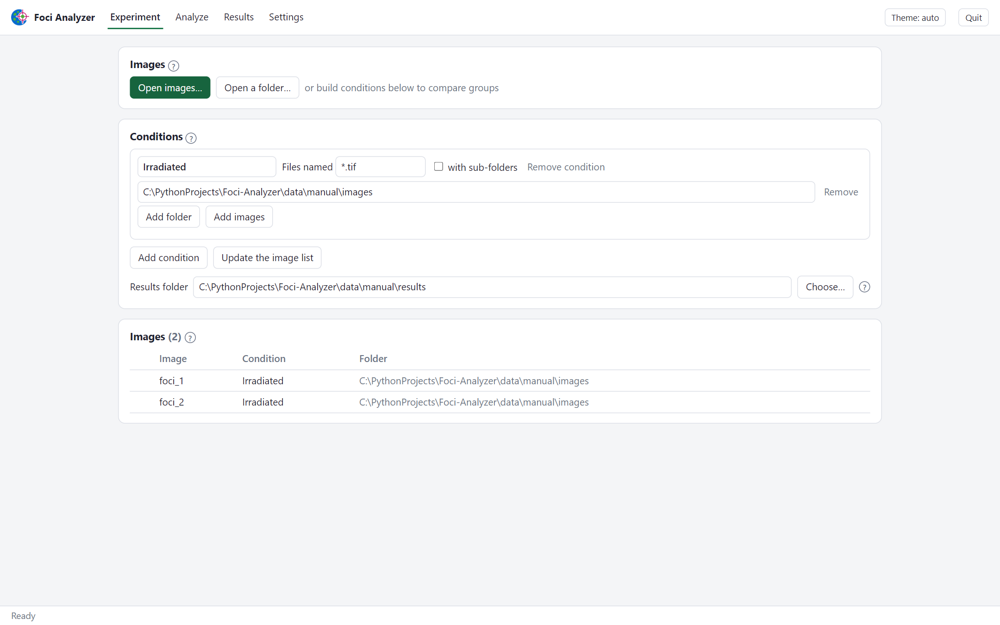

# The Experiment page

The Experiment page says which images belong to the analysis, how they are grouped, and where the results
go. Foci Analyzer remembers it when you close the window.

## Images: the quick way

**Open images…** and **Open a folder…** add images to one condition called *Images*. They appear in the
list at the bottom; click one to open it on the Analyze page. Opening more images later adds them to the
same condition.

## Conditions

A condition is a group of images that belong together, for example *control* and *irradiated*. The
Results page compares conditions.

- **Add condition** adds a group; type its name in the first box.
- **Add folder** and **Add images** add folders or single files to a condition. Without a file dialog
  (for example on a server) an empty box appears in which a path can be typed or pasted.
- **Files named** filters the files by name: `*` stands for anything, so `*DAPI*` takes only files
  with DAPI in the name. The extension may be given or left out (`*.tif` and `*` both work).
- **with sub-folders** also looks in the folders inside the folder.
- **Remove** and **Remove condition** take a folder or a whole condition out of the experiment (nothing is
  deleted from the disk).

A condition can have several folders. Each folder then counts as one experiment (a biological replicate)
in the statistics, with **Test per** *folder* on the Results page.

The image list updates itself after every change. **Update the image list** looks again in all folders,
for example after you typed a folder name or copied new images into a folder.

## Files with several images

A CZI file with several scenes, or a LIF file with several series, gives one image per scene or series in
the list (for example *DKO-2-11_0hR_Olap · Series008*). They are analyzed as separate images.

## The image list

One row per image, with its condition and folder. A green ✓ means that **Analyze all images** analyzed
the image with the current settings, so its result is in the results folder; a grey ✓ that it was
analyzed with other settings. Click a row to open the image on the Analyze page.

## Results folder

Where the tables, pictures and settings of the analysis are written. Left empty, it is a folder
`Foci_Analyzer_results` next to the first image. It also holds the list of cells you removed from the
analysis by hand (see [The viewer](viewer.md#removing-cells-from-the-analysis)), so keep using the same
results folder for the same experiment. Contents: [The results folder](output-folder.md).
