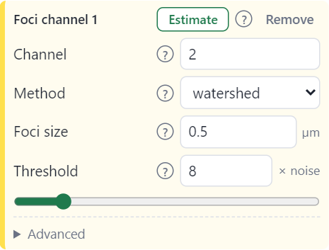
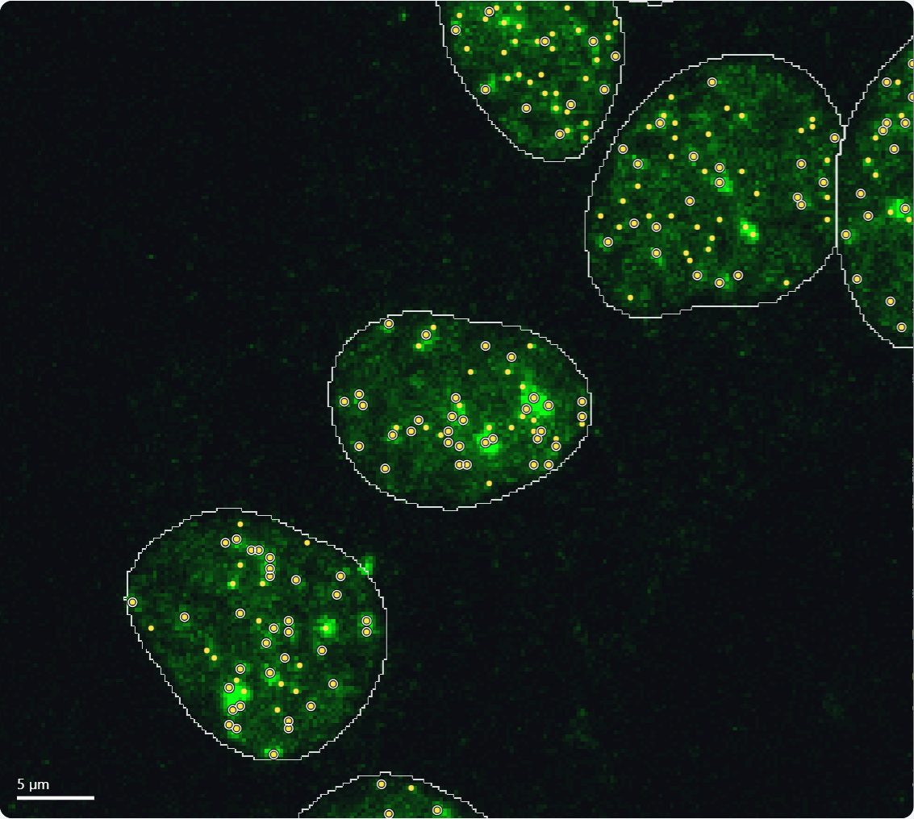
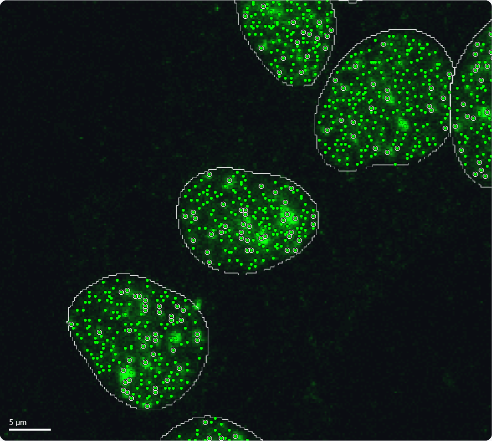
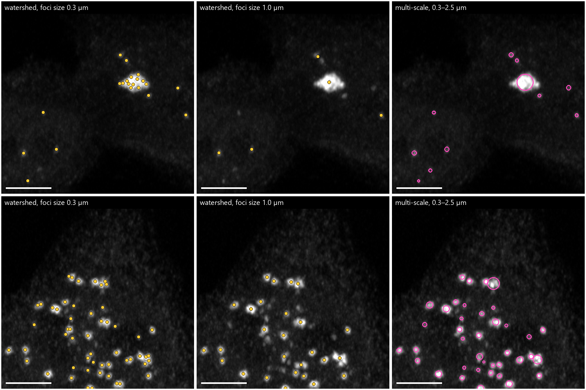
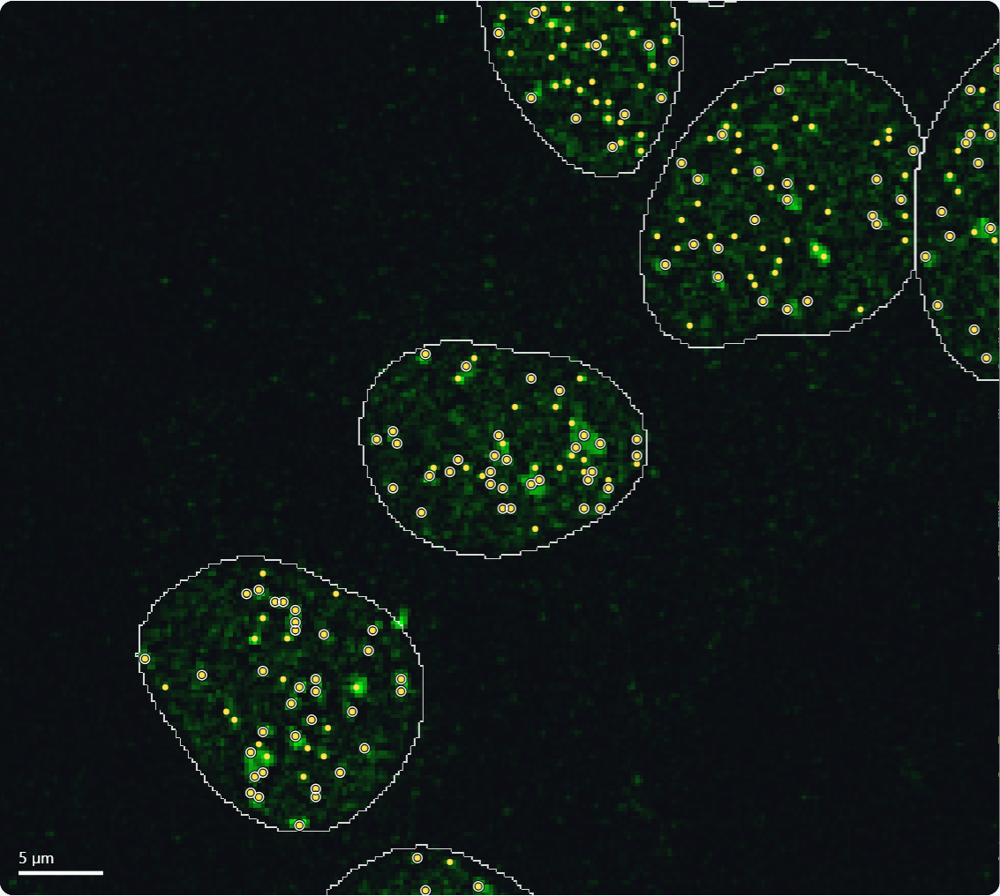

# Foci detection

Foci are found per **foci channel** (the groups under *Foci channels* on the Analyze page; **Add** makes
another one). Each channel has its own method, size and threshold. The settings that apply to all foci
channels are in the section **Foci** above them. This page explains what every setting does and how to set
them; [How the analysis works](../reference/analysis.md#3-foci) has the steps in short, and
[All settings](../reference/settings.md) the defaults and limits.

<figure markdown>
{ width="320" }
<figcaption>A foci channel with the watershed method: the <b>Estimate</b> button with its <b>?</b>, the foci size,
and the threshold with its slider. The advanced settings are under <b>Advanced</b>.</figcaption>
</figure>

## Three methods

| | **watershed** | **multi-scale** | **spotiflow** |
|---|---|---|---|
| How spots are found | a filter makes spots of the *Foci size* stand out; every local maximum higher than *Threshold* × the noise is a focus | the same at several sizes in a range; each focus is found at the size where it stands out most | the neural network [Spotiflow](https://weigertlab.org/spotiflow/) finds spots and gives each a probability; those above *Spotiflow probability* are foci |
| You set | *Foci size*, *Threshold* (and the filter) | *Foci size range*, *Threshold* | *Spotiflow probability*, the model; *Foci size* only sets the scale |
| Needs | nothing extra | nothing extra; about 3 to 5 times the time of watershed | Spotiflow installed (Settings page) |
| Strong in | foci of one typical size, also large or irregular ones; full control; 3D | foci of very different sizes in one image: one focus per large focus, and the small ones still found; a size per focus | small, round, diffraction-limited spots (FISH-like); uneven background; little tuning |
| Weaker in | very uneven background, spots of very different sizes | long or irregular foci (only fairly round peaks count); slower on large stacks | large or irregular foci, which are not what it was trained on |
| Extent of a focus | grown from its peak (see *Focus extent*) | grown from its peak down to half of its own height above the background | the same way, on the filtered image at the *Foci size* |

Start with **watershed**: it works on almost every image and its two numbers are easy to understand. Choose
**multi-scale** when the foci differ much in size, so that with one *Foci size* the large foci fall apart into
several, or the small ones are missed. Try **spotiflow** when the foci are small spots and the watershed finds
too many noise peaks or misses spots on a bright background.

## The watershed method

### Foci size

The expected diameter of a typical focus, in µm, measured as the *full width at half maximum*: the width of
the focus at half of its height above the background. It is the most important setting, because it does three
things:

1. **The filter scale.** The filter makes spots of about this size stand out and removes everything that is
   much smaller (pixel noise) or much larger (the background, the nucleus itself).
2. **The smallest distance between two foci.** Two peaks closer together than about half the foci size count
   as one focus.
3. **In 3D, the size in Z**: the foci size × *Axial elongation*.

Too small: one large focus falls apart into several, and noise peaks become foci. Too large: neighboring
foci merge into one, and small foci are weakened by the filter and drop below the threshold. When the foci
differ in size, take the size of the typical focus rather than of the largest.

### Threshold

A local maximum of the filtered image becomes a focus when its height is at least *Threshold* times the
**noise**. Between the foci, the filtered image still goes up and down a little by chance (camera noise,
uneven staining). The noise is the typical size of those random ups and downs inside the cells: 1.4826 times
the median absolute deviation of the filtered image, which equals the standard deviation for pure noise but
is hardly raised by the foci themselves. So a threshold of 8 means: eight times higher than the usual ups and
downs. **This image** on the right of the viewer shows the noise and the threshold of the shown image.

Because the threshold is relative to the noise, the same value works for images of different brightness or
exposure. Lower values find more and fainter foci, but also more peaks that are only noise; higher values
keep only the clear foci. The foci markers in the viewer follow the slider at once, without a new analysis.

<figure markdown>

<figcaption>Threshold 8 (the default): a marker on the clear foci.</figcaption>
</figure>
<figure markdown>

<figcaption>Threshold 3: also many peaks of the noise.</figcaption>
</figure>

Foci channel 2 of the example; a ring around a marker means that the focus colocalizes with a focus of
another channel.

### Estimate

The **Estimate** button in the head of a watershed foci channel fills in *Foci size* and *Threshold* from the
image in the viewer, as a starting point. It needs the cells, so press **Analyze this image** first.

- **Size**: the median width at half height of the 300 brightest peaks in the cells, measured in eight
  directions around each peak, and corrected for the slight smoothing used to find them.
- **Threshold**: with that size, the foci are counted at many thresholds. Low thresholds count the many peaks
  of the noise, high thresholds only the foci; in between, the number often hardly changes (a *plateau*, as in
  the TrueSpot method). If there is such a plateau, the threshold is taken
  where it is flattest. If not, *Otsu's method* splits the peak heights (on a log scale) into a low group, the
  noise, and a high group, the foci, and takes the threshold between them.

The status bar says which of the two was used and about how many foci it gives. With *Noise from* `fixed
value`, the estimate fills in the *Fixed threshold* instead. Check the result in the image: the estimate does
not know which spots you want to count. It works less well when there are many small faint spots that should
not count; a larger *Foci size*, then **Estimate** again, usually helps.

## The multi-scale method

**Foci size range** (two numbers, and a slider with two ends): the smallest and the largest foci, as full
width at half maximum (default 0.5 to 2.5 µm). The image is filtered at sizes from the one to the other, each
about 1.35 times the previous (at most 8 sizes).

<figure markdown>

<figcaption>Foci of very different sizes (a 63× stack, maximum projection; scale bars 5 µm).
With a small foci size (left) the large focus falls apart into many; with a large one (middle) the small foci are
missed. Multi-scale (right) finds the large focus once and the small ones as well; each circle is as wide as the
size at which the focus was found.</figcaption>
</figure>

How it works:

1. At every size, the image is filtered with a Laplacian of Gaussian, *scale-normalized* (Lindeberg) so that
   the sizes can be compared. Each point keeps the size at which it stands out most: a focus of 1 µm stands
   out most at about 1 µm. In a stack the sizes vary in X and Y only; in Z the filter keeps the width of the
   smallest size, because in Z foci are mostly as large as the microscope makes them.
2. **Threshold**: the noise is measured at every size separately (finer sizes are noisier), and a peak is a
   focus when it is *Threshold* times the noise *at its own size*. So the threshold means the same as with
   the watershed method, and the *Filtered* view and *Noise from* work as there.
3. **Round peaks only**: a peak counts when the image curves down in both directions around it. A focus does;
   the edge of a bright nucleus, which also stands out at large sizes, curves in one direction only. Foci up to
   about 2.4 times as long as wide are kept.
4. **One focus per focus**: from the highest peak down, every focus removes the lower peaks within its own
   radius. A large focus is then one focus, while two small foci side by side stay apart.
5. **Extent**: every focus grows from its peak down to half of its own height above the background, so its
   size follows the focus itself. The size at which it was found is in the column `detected_size` of
   `foci.tsv`.

**Estimate** for this method filters the image over a wide range of sizes, finds the threshold as described
above, and takes the range from the sizes of most foci above it (the 10th to the 90th percentile, the upper end
one size step wider).

A wider range costs time (each size is one more filtering): set it no wider than the foci need. When all foci
are about the same size, the watershed method is as good and faster.

## The Spotiflow method

- **Spotiflow probability** (0 to 1, default 0.5): spots below this probability are left out. Lower finds
  more and fainter spots. The markers follow the slider at once. Below 0.1 nothing more is found: spots
  under 0.1 are not kept.
- **Spotiflow model**: *general* fits most fluorescence images; the others are trained on one kind of image
  (see [Models](../reference/models.md)). The 3D models need a stack and *Detect foci in* `3D`. A 2D model on
  a stack finds the spots in the maximum projection and takes the slice of the brightest value.
- **Foci size** does not decide what counts as a spot here. Spotiflow was trained on spots about 3 pixels
  wide: when the foci are not 1.5 to 5 pixels wide, Foci Analyzer resizes the image for the network (by at
  most a factor 4) so that they are, and converts the positions back. The size also sets how the extent of
  each focus is measured.
- There is no *Filtered* view and no *Estimate* for Spotiflow.

## Advanced settings of a foci channel

**Filter** (watershed): how the spots are made to stand out.

- `DoG` (default): the difference of two Gaussian blurs around the foci size. Robust; the right choice for
  most images.
- `LoG`: the Laplacian of Gaussian at the foci size. Slightly sharper, so close foci separate a little better,
  but more sensitive to noise.
- `wavelet`: the product of two neighboring à trous wavelet planes (Olivo-Marin, 2002). Noise that is in one
  plane only is suppressed. Good for foci of mixed size on an uneven background.

All three work in 3D for 3D detection. The threshold is relative to the noise of the chosen filter, so after
changing the filter the same threshold value gives roughly comparable results, but check it.

**Round foci only** (watershed; off by default): only peaks around which the image curves down in every
direction in XY count. A focus does; the edge of a bright nucleus or nucleolus, or a bright streak, curves in
one direction only, and so does a side peak on the flank of a larger focus. Foci more than about 2.4 times as
long as wide are left out too, and sometimes one of two foci that touch. On test images it removed 1 to 8 % of
the foci, mostly such side peaks and peaks on the rim of the nucleus. The multi-scale method always does this.

**Focus extent** (watershed): where a focus ends, which sets its size and integrated intensity.

- `half maximum` (default): every focus grows from its peak down to half of its own height. Its size then does
  not depend on the threshold, so sizes compare well between conditions.
- `threshold`: every focus grows down to the threshold. Faint foci become small, bright foci large; the size
  depends on the threshold.

In both cases a focus never grows into another focus or out of its cell.

**Smallest focus** and **Largest focus** (in voxels; pixels in 2D): foci outside these limits are removed
after their extent is known. *Smallest focus* removes single hot pixels that passed the threshold; *Largest
focus* removes large bright blobs (debris, nucleoli, whole bright cells) that are not foci.

**Noise from** (watershed): where the noise for the threshold comes from.

- `per image` (default): one noise value from all cells of the image.
- `per cell`: every cell its own noise. Useful when cells differ strongly in their background (for example
  pan-nuclear staining in some cells): a cell with a noisy background then needs higher foci.
- `fixed value`: one absolute threshold, in the units of the filtered image, for all images (*Fixed
  threshold*). The fair choice when conditions differ strongly in foci numbers, so that the noise itself
  differs between them. **This image** shows the value that the threshold of the current image comes to,
  which is a good starting value.

## Settings for all foci channels (section Foci)

**Detect foci in** (for stacks; 2D images ignore it):

- `3D`: foci are found in the stack, with filters in X, Y and Z. Every focus has a slice, and foci above
  each other are kept apart.
- `max projection`, `sum projection`, `extended depth of focus` (every pixel from the slice where it is
  sharpest): foci are found in one plane. Often more reliable for thin samples and few slices; faster.

With cells segmented in 3D (*Segment in* `3D`), only `3D` is possible.

**Axial elongation** (Advanced, default 2×): how much longer a focus is in Z than in X and Y, because of the
optics of the microscope. Used for the filter size in Z. A confocal with a high-NA objective gives about 2 to
3; check it on an XZ view in Fiji if Z matters to you.

**Cell border shift** (Advanced, µm): moves the border within which foci count for a cell. Positive: foci up
to this distance outside it still count (useful when the nuclear stain is a little smaller than the foci
signal). Negative: the border moves inward, so foci near the edge are left out. The cell measurements always
use the outline as found.

**Foci in the whole image** (Advanced): every focus counts for the nearest cell, wherever it is; the shift is
then not used. This also gives cells the foci of a cell that was left out (for example one on the image edge)
when they are nearer to them.

## Tuning the detection

1. Open a typical image and press **Analyze this image** (++a++). Turn on **Foci markers** (++m++) and zoom
   in on a few cells.
2. Press **Estimate** in the foci channel for a starting point (watershed).
3. **Check the size.** Switch to **Filtered** (++r++): foci should be round spots of about their own size.
   A focus that shows as two or three spots needs a larger *Foci size*; foci that run together, a smaller one.

    <figure markdown>
    { width="520" }
    <figcaption>The same nuclei as above, <b>Filtered</b>: the smooth background of the nucleus is gone, spots of the foci size stand out.</figcaption>
    </figure>
4. **Set the threshold.** In the filtered view, 100 % is exactly the threshold. Move the slider until the
   clear foci all have a marker and the background between them has none. Look at cells with few foci and
   at cells with many: both should look right.
5. **Check the extent.** Turn on **Foci outlines** (++f++): the outlines should follow the foci. If debris or
   other large blobs are counted, lower *Largest focus*; for single bright pixels, raise *Smallest focus*.
6. **Check other images**, from every condition, especially the one with the fewest and the one with the
   most foci. With **Live** on, every change analyzes the shown image again.
7. **Keep the settings the same** for all images you want to compare, and save them (**Save settings…**).
   The results folder also keeps them, in `settings.toml`.

Some signs and what to do:

| What you see | Try |
|---|---|
| Markers on the background between foci | a higher *Threshold* (or *Probability*) |
| Faint but real foci without a marker | a lower *Threshold*; for small foci on a bright nucleus also `wavelet` |
| One large focus with two or more markers | a larger *Foci size*; when there are small foci too, the *multi-scale* method |
| Two foci close together with one marker | a smaller *Foci size*, or `LoG` |
| Foci counted in nucleoli or debris | a lower *Largest focus*, or a higher *Threshold* |
| Markers in a row along the edge of the nucleus, or beside large foci | *Round foci only* |
| Very different foci counts in cells that look alike, while the background differs | *Noise from* `per cell` |
| One condition has far more foci and the threshold seems to shift with it | *Noise from* `fixed value` |
| Foci at the edge of the nucleus missing | *Cell border shift* of 0.5 to 1 µm |
| Many cells in *Cells to check* with many foci | check those cells in the viewer: often debris or a dividing cell |
