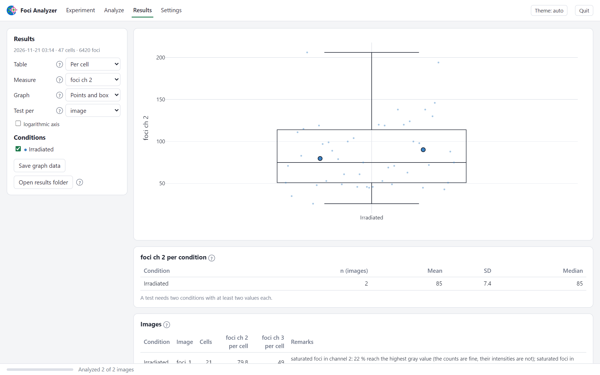

# The Results page

The Results page shows the tables of the last **Analyze all images** as graphs, compares the conditions,
and lists the images and the cells that need a second look. When the settings have changed since that
run, a banner says so: the results then belong to the earlier settings.

## Choosing what to show

- **Table**: *Per cell* (one value per nucleus or cell, for example its number of foci) or *Per focus* (one
  value per focus, for example its size). With per focus, **Channel** chooses the foci channel.
- **Measure**: the column of the table; see [Table columns](../reference/tables.md).
- **Graph**:
    - *Points and box*: every cell a small dot, the box the median and quartiles, the large dots the mean
      per image.
    - *Violin* and *Histogram*: the distribution per condition.
    - *Scatter*: two measures against each other (**Against** chooses the second).
    - *Over time*: the mean per frame of a time-lapse.
    - *Tracks*: one line per tracked cell, with the mean per condition (needs tracking).
    - *Colocalization*: per pair of foci channels, the share of the foci of one channel that lie on a
      focus of the other, per cell, with in grey the share expected by chance. A share clearly above the
      grey box means real colocalization.
- **logarithmic axis** for measures that span orders of magnitude.
- **Conditions**: switch conditions on or off.

Click a point in the graph to open that cell in the viewer.

## Comparing conditions

The table under the graph gives per condition the number of values, mean, standard deviation and median,
and the p-value of every pair of conditions. **Test per** says what counts as one independent value:

- *cell*: every cell (Mann-Whitney test). Cells of one image are not independent of each other, so this
  easily gives very small p-values.
- *image*: the mean per image (Welch t-test).
- *folder*: the mean per folder, when every folder of a condition is one experiment (Welch t-test). This is
  the careful choice for biological replicates.

All p-values of a comparison are corrected for multiple testing (Holm).

## Images, and cells to check

**Images** lists every image with its number of cells and mean foci per cell (in a time-lapse the cells of
all frames together: 9 cells in 12 frames count as 108); click a row to open the
image. **Cells to check** lists cells with a remark in the `check` column of the table, for example a cell
on the image edge or with many saturated foci; click one to see it in the viewer, and remove it from the
analysis there if needed ([The viewer](viewer.md#removing-cells-from-the-analysis)).

## Saving

**Save graph data** writes the values of the current graph as a tab-separated table (`graph_<measure>.tsv`)
into the results folder. **Open results folder** opens that folder. The graph itself can be saved as a
picture with the camera icon above it.
