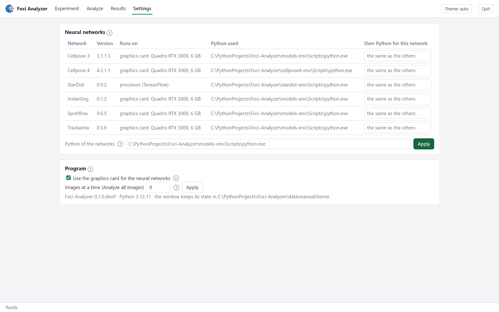

# The Settings page

The Settings page holds the settings of this computer, not of an analysis: they are not saved with the
analysis settings.

## Neural networks

The table lists every network with its version, whether it runs on the graphics card or the processor, and
which Python environment runs it. Opening the page asks the networks themselves, which takes a few seconds.

- **Install**: a network that is not installed has this button instead of a version. It downloads the
  network into the folder of Foci Analyzer (a few GB; minutes). The messages of the installer appear under
  the table. Close other Foci Analyzer windows first: a network that is in use cannot be replaced.
- **Own Python for this network**: use a network from a Python environment of your own, for example an
  existing Cellpose installation: give its `python.exe` (Windows, in the `Scripts` folder of the
  environment) or `bin/python` (macOS, Linux), and click **Apply**.
- **Python of the networks**: the same for all networks at once. Empty: the environments installed with
  Foci Analyzer.

Cellpose 3 and Cellpose 4 are separate rows, because they cannot be installed in the same environment: the
models *nuclei*, *cyto3* and *tissuenet_cp3* need Cellpose 3, *cpsam_v2* and *cpdino-vitb* Cellpose 4.

## Program

- **Use the graphics card for the neural networks**: off makes the networks run on the processor; slower,
  but it leaves the graphics card free or avoids running out of its memory.
- **Images at a time (Analyze all images)**: how many images are analyzed side by side. 0 = automatic: half
  the processors (at most 6), or 3 when a neural network is used. Lower it when the computer runs out of
  memory on large images.

The line below gives the version of Foci Analyzer and the folder where the window keeps its state (the last
settings and experiment).
