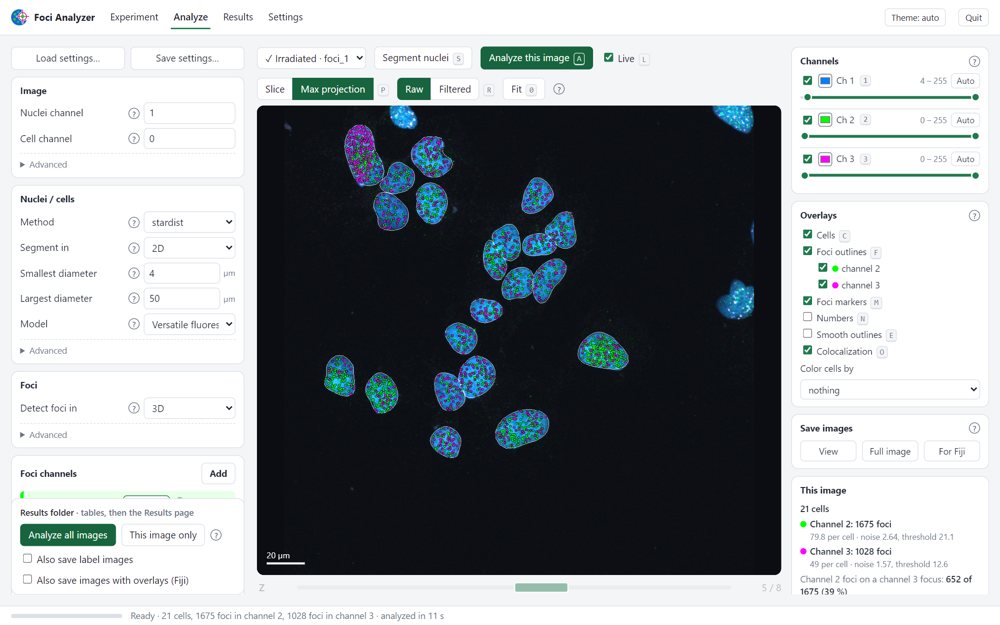

# The viewer

The viewer shows the image with the result of the analysis on top. It loads large images in tiles, at the
resolution that the zoom needs.

## Moving around

- **Mouse wheel**: zoom; **drag**: move; **Fit** (++0++): the whole image.
- **Ctrl** + wheel: the next or previous Z slice; **Alt** + wheel: the next or previous time frame.
- **Slice** and **Max projection** (++p++ switches): one Z slice or the brightest value over Z. When the foci
  are detected on another projection (extended depth of focus or sum), a third button shows that one.
- Under the viewer, a stack has a **Z** slider (++comma++ and ++period++) for the slice, and a time-lapse a
  **T** slider (++bracket-left++ and ++bracket-right++) for the time frame, with a play button that steps
  through the frames (four per second, round and round; press it again to stop). In an image without frames
  ++bracket-left++ and ++bracket-right++ step through the slices. The Z slider is dimmed in a projection.
  Each time frame is analyzed on its own: with **Live** on, a frame you move to is analyzed as soon as the
  image has been analyzed in the viewer (or it is shown from the last **Analyze all images**); otherwise
  press **Analyze this image** (++a++) for it.
- The image list above the viewer chooses the image. A ✓ marks analyzed images: green, in the results
  folder with the current settings; blue, analyzed in the viewer with the current settings; grey, analyzed
  with other settings.

All keys: [Keys](../reference/keys.md).

## Channels

<figure markdown>
{ width="280" }
</figure>

Per channel: the box shows or hides it (keys ++1++ to ++9++), the coloured square chooses its colour, and the
two ends of the slider set the darkest and brightest value shown. **Auto** sets the contrast from the image.
This changes the display only, never the measurements. The display stays the same when you open another
image with the same channels.

## Overlays

- **Cells** (++c++): the outlines of the nuclei or cells. When *Cell border shift* is set, a thin dashed grey
  line shows the border within which foci count for a cell: outside the outline when the shift is positive,
  inside it when it is negative.
- **Foci outlines** (++f++): the detected foci, lightly filled, in the colour of their foci channel; per
  channel they can be switched off.
- **Foci markers** (++m++): a dot on every focus. The dots follow the threshold slider at once; the outlines
  when the analysis has been repeated. When zoomed in, a ring with a black and white edge marks a focus that
  colocalizes with a focus of another channel.
- **Numbers** (++n++): the number of every cell, as in the tables, when it is large enough on the screen.
- **Smooth outlines** (++s++): outlines as smooth lines instead of along the pixel edges.
- **Colocalization** (++o++): colocalizing foci get a white outline with a black edge; where foci of two
  channels lie on top of each other is hatched.
- **Colour cells by**: fills every cell with a colour for one of its numbers (for example the number of
  foci), from dark blue (lowest) to yellow (highest). The numbers are grouped: *Cell* (area, mean intensity
  per channel), *Foci in channel N* (number of foci, their total and mean intensity and size), and
  *Colocalization* (Pearson correlation, colocalizing foci, shares, Manders coefficients, chance level). Drag the two ends of the slider below the colour
  scale to change its range. *label* gives every cell its own colour, which shows where one cell ends and
  the next begins; useful to judge a 3D segmentation slice by slice.

## The selected cell

Click a cell: its outline turns yellow, and **Selected cell** on the right lists its numbers (the same as
in `cells.tsv`). **This image** above it gives the totals of the image: cells, foci per channel, the noise
and threshold, and the colocalization.

<figure markdown>
{ width="280" }
</figure>

## Removing cells from the analysis

A cell that should not count (a mitotic or dead cell, two nuclei found as one, debris) can be left out:
select it and click **Remove from the analysis** (or press ++x++). It gets a red outline and leaves the
tables, together with its foci. Click it and press the button again (**Put back in the analysis**) to
undo.

Several cells at once: hold **Ctrl** and click cells to add them to the selection (or drop one again), or hold
**Shift** and drag a box: the cells whose centre lies in it are added. All selected cells get a yellow outline,
and the button says, for example, **Remove 6 cells from the analysis** (or **Put 6 cells back** when they are
all removed). ++esc++ or a click without Ctrl clears the selection.

Removed cells are remembered in the results folder, in `removed_cells.tsv`, as the points you clicked. So a
removed cell stays removed when the image is analyzed again, even with other segmentation settings: the
cell at that point is left out. Run **Analyze all images** again to update the tables in the results
folder. A different results folder starts without removed cells.

## Saving pictures

The **Save images** section writes into the results folder:

- **View**: a PNG of the viewer as you see it (folder `pictures`).
- **Full image**: the shown slice or projection at full resolution, with the channels and overlays as
  shown, as an RGB TIFF (folder `pictures`).
- **For Fiji**: the whole image (all channels, slices and frames) as a TIFF that opens in Fiji with the
  outlines of the cells and foci as overlay (folder `images`). It is saved in a `.zip`, about four times
  smaller; Fiji opens the `.zip` directly.

The button shows a green tick for a moment, and the line under the buttons names the file, with **Show in
folder** to open the folder it is in.
