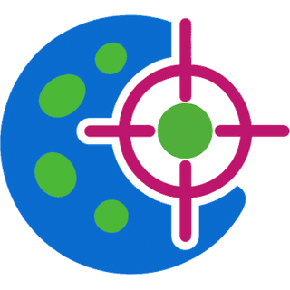
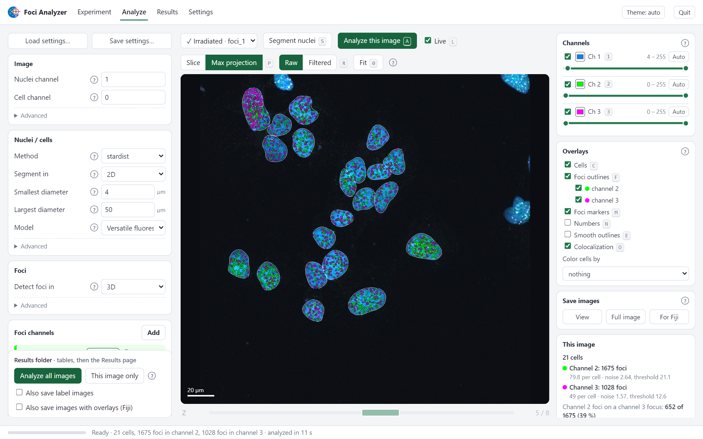
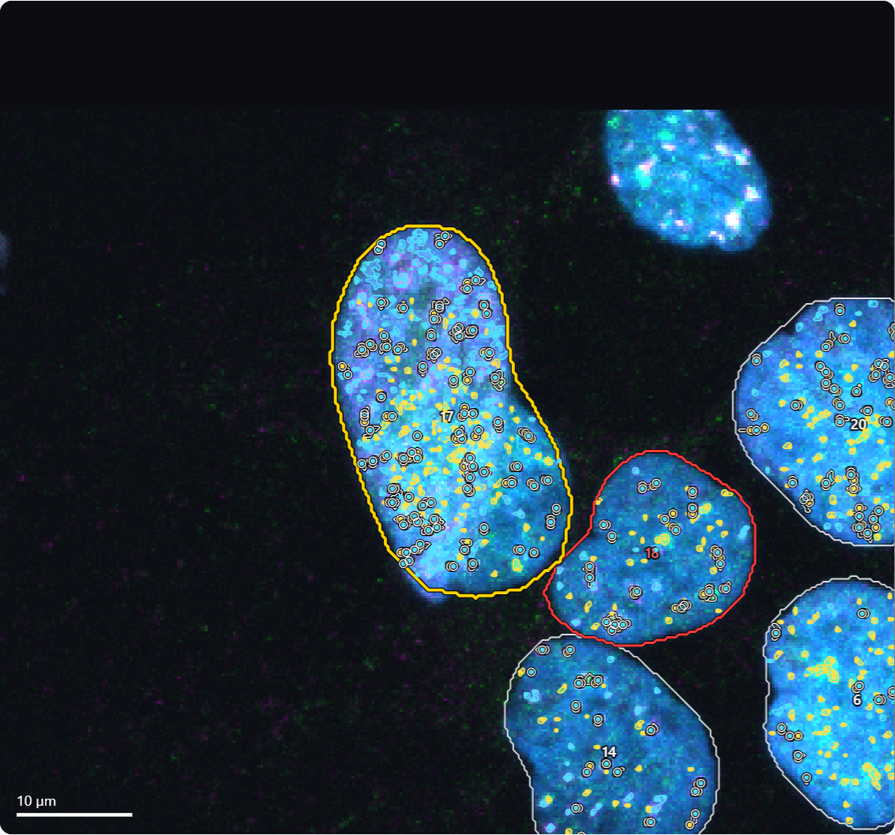
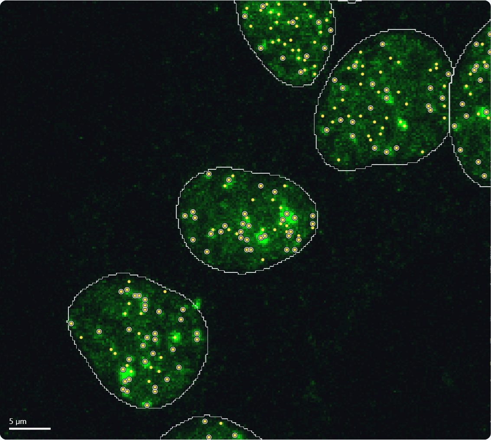
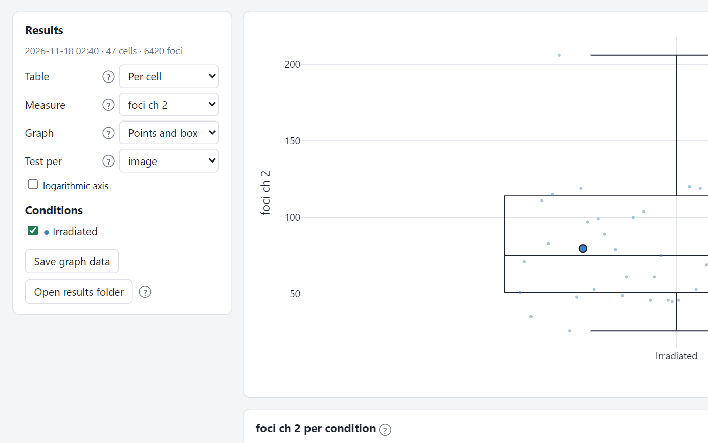
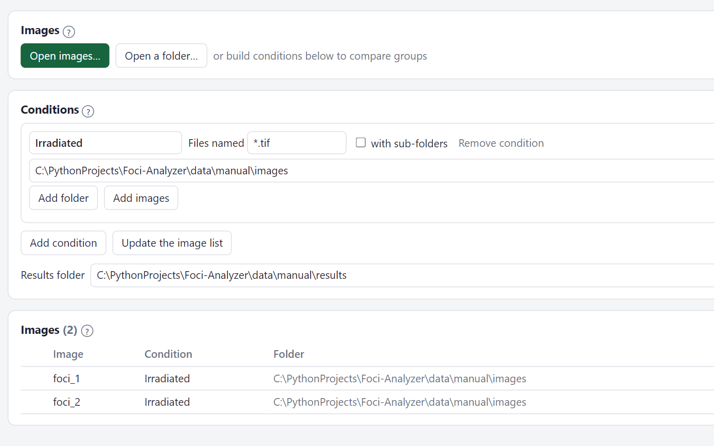

<!-- the hero is plain HTML: inside a Markdown block, nested HTML on one line is cut apart -->

<h1 id="foci-analyzer">Foci Analyzer</h1>

Detection, quantification and colocalization of foci in nuclei and cells, in 2D and 3D.

Foci Analyzer segments the nuclei or cells, finds the foci of one or more channels (for example DNA-damage foci
of γH2AX, 53BP1 or RPA), measures their number, size and intensity per cell, and compares conditions with
statistics. It runs in your web browser, on your own computer: images and results never leave it.

<a class="md-button md-button--primary" href="start/install/">Get started</a>
<a class="md-button" href="https://github.com/BioImaging-NKI/Foci-analyzer/releases/latest">Download</a>

<figure class="fa-shot">

<figcaption>The Analyze page: the settings, the image with its nuclei and foci, and the numbers of the image.</figcaption>
</figure>

## From images to numbers { .fa-center }

Set up the analysis while you look at the result, then analyze every image and compare the
conditions.

-   :material-folder-multiple-image:{ .lg } **1 · Experiment**

    Open images or folders, one condition per group to compare. TIFF, CZI and LIF; 2D, stacks and
    time-lapses, also large stitched images. [The Experiment page](guide/experiment.md)

-   :material-tune-variant:{ .lg } **2 · Settings**

    Nuclei or cells with StarDist, Cellpose, InstanSeg or a threshold; foci with a filter and a threshold in
    units of the noise, or with Spotiflow. The result follows every change. [Foci detection](guide/foci.md)

-   :material-play-circle-outline:{ .lg } **3 · Analyze all images**

    All images side by side, with tables per cell and per focus, label images and images for Fiji in the
    results folder. [The results folder](guide/output-folder.md)

-   :material-chart-box-outline:{ .lg } **4 · Results**

    Graphs per condition with tests that treat the images, not the cells, as replicates; colocalization
    against chance; cells to check. [The Results page](guide/results.md)

## Features { .fa-center }

-   

    **[A live viewer](guide/viewer.md)** for large 2D and 3D images and time-lapses: nuclei, foci outlines and
    markers, colocalization, and a click on a cell gives its numbers. Cells can be removed by hand.

-   

    **[Foci detection](guide/foci.md)** with a threshold relative to the image noise, so one value fits images
    of different brightness. **Estimate** proposes the foci size and threshold.

-   

    **[The Results page](guide/results.md)**: foci per cell, sizes, intensities and colocalization per
    condition, with statistics; a click on a point opens that cell in the viewer.

-   

    **[Experiments](guide/experiment.md)** with conditions and replicate folders; series of LIF and scenes of
    CZI files become images of their own. Time-lapses are tracked.

## Where to start { .fa-center }

-   :material-download:{ .lg } **[Install it](start/install.md)** on Windows, macOS or Linux, with the neural
    networks you choose.

-   :material-school-outline:{ .lg } **[Your first analysis](start/first-analysis.md)**: a walk-through from
    images to a graph, with example data.

-   :material-book-open-variant:{ .lg } **[How the analysis works](reference/analysis.md)** and
    **[all settings](reference/settings.md)**, each with its default and explanation.

!!! note "Beta"
    Foci Analyzer 2 is the Python successor of the Fiji macro
    [Foci Analyzer](https://imagej.net/plugins/foci-analyzer) (versions 1.x, now in
    [Foci-analyzer-Fiji](https://github.com/BioImaging-NKI/Foci-analyzer-Fiji)). It has its own methods and does
    not reproduce the Fiji results exactly. Questions and problems:
    [Issues on GitHub](https://github.com/BioImaging-NKI/Foci-analyzer/issues).
