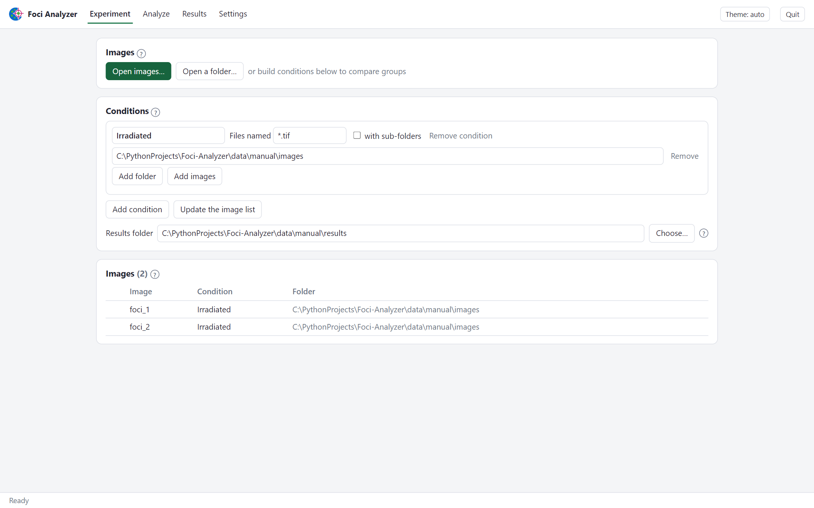
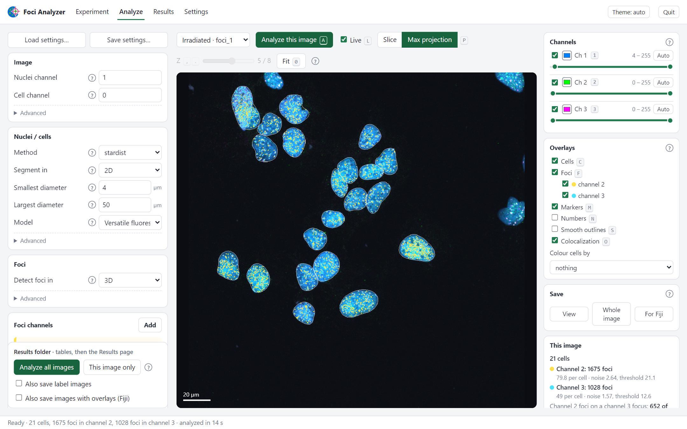
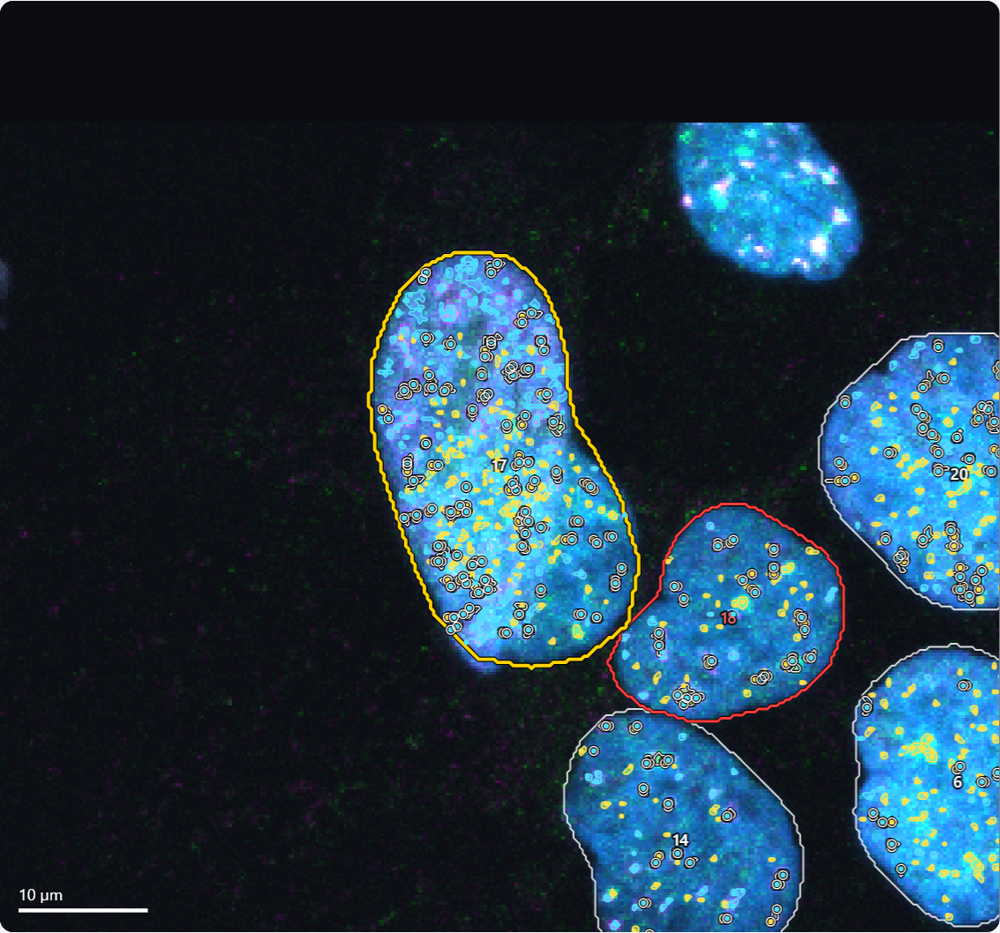
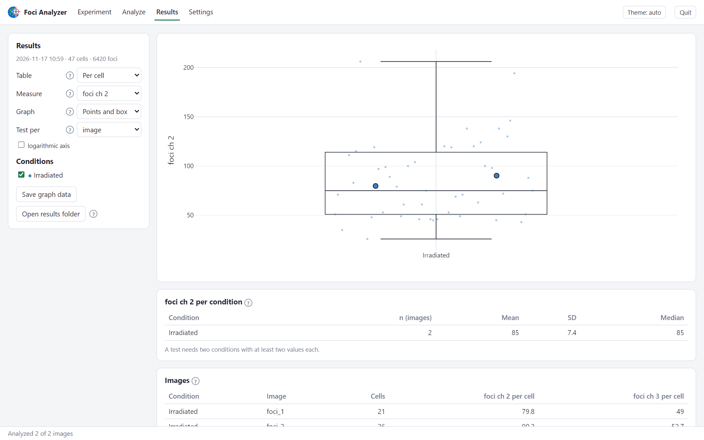

# Your first analysis

This walk-through goes from two images to a graph in about ten minutes. The example: two confocal stacks
(1024 × 1024 pixels, 8 slices, 0.24 µm pixels) of irradiated cells with three channels: nuclei (DAPI) in
channel 1, and foci of two DNA-damage proteins in channels 2 and 3.

## 1. Choose the images

On the **Experiment** page, click **Open a folder…** and choose the folder with the images. They appear in
the list at the bottom of the page, as one condition called *Images*; type another name in its box if you
like (here: *Irradiated*). To compare groups, make one condition per group instead
([The Experiment page](../guide/experiment.md)).

The **Results folder** is where the tables go. Left empty, it is `Foci_Analyzer_results` next to the first
image; **Choose…** picks another one.

## 2. Open an image

Click an image in the list. The **Analyze** page opens with the image in the viewer, as a maximum
projection. Nothing is analyzed yet: first check the settings on the left.

## 3. Check the settings

The settings that matter most are visible; the others are under **Advanced**. For the example:

- **Image**: *Nuclei channel* 1, *Cell channel* 0 (no cytoplasm stain: foci are counted per nucleus).
- **Nuclei / cells**: *Method* `stardist`, *Segment in* `2D` (the nuclei are found in the maximum
  projection; fast and robust).
- **Foci**: *Detect foci in* `3D`.
- **Foci channels**: click **Add** for a second foci channel; *Channel* 2 and 3, *Foci size* 0.5 µm,
  *Threshold* 8.

Every setting has a **?** with an explanation. All settings with their defaults are listed in
[All settings](../reference/settings.md).

## 4. Analyze this image

Click **Analyze this image** (or press ++a++). The status bar at the bottom shows what is being done. The
first time, starting the neural network takes up to a minute; after that, a change of a setting gives a new
result in seconds. For the first example image: 21 nuclei, 1675 foci in channel 2 and 1028 in channel 3.

Zoom in with the mouse wheel and look whether the nuclei and foci are found well. With **Live** on, every
change of a setting analyzes the image again. Move the *Threshold* slider of a foci channel: the markers
(the dots) follow at once, the outlines when the new analysis is done.

Click a nucleus to see its numbers on the right. A nucleus that should not count (a mitotic cell, a
segmentation error) can be removed with **Remove from the analysis** (++x++); see
[The viewer](../guide/viewer.md#removing-cells-from-the-analysis).

## 5. Analyze all images

When the settings are right, click **Analyze all images**. All images of the experiment are analyzed with
these settings, the tables are written to the results folder, and the **Results** page opens.

The example gives 21 and 26 nuclei, with on average 79.8 and 90.2 foci of channel 2 per nucleus. With more
conditions, the table below the graph compares them with a test; see
[The Results page](../guide/results.md).

## 6. Use the tables

The results folder holds `cells.tsv` (one row per nucleus) and `foci.tsv` (one row per focus), which open in
Excel, R or Python, and `settings.toml`, the settings of this analysis. **Load settings…** on the Analyze
page reads that file back, so the same analysis can be repeated on new images. See
[The results folder](../guide/output-folder.md) and [Table columns](../reference/tables.md).
